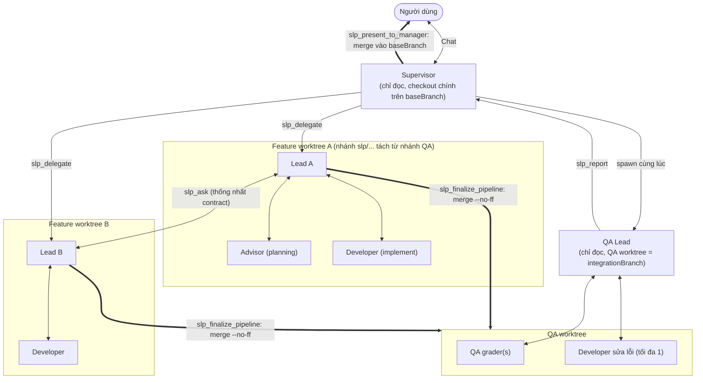
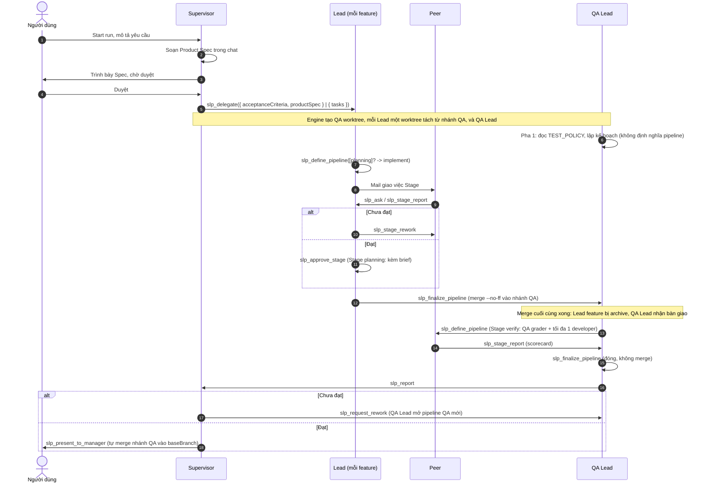

# Paseo SLP Orchestrator (`paseo-slp-orchestrator`)

**SLP Orchestrator** là plugin điều phối nhiều agent cho **Paseo**, theo mô hình phân cấp **Supervisor – Lead – Peer (SLP)** với pipeline do Lead tự định nghĩa (`dynamic-stages-v1`).

Bạn chỉ trò chuyện với **Supervisor**. Supervisor viết Product Spec cùng bạn, rồi giao mỗi feature cho một **Lead** riêng chạy trong Git worktree riêng. Mỗi Lead điều phối các **Peer** theo quy trình khai báo trong `.slp/` của dự án. Mọi feature được merge vào một nhánh QA chung. **QA Lead** kiểm thử nhánh đó trước khi Supervisor nghiệm thu và merge vào nhánh gốc.

### Kanbanly R1

Với board Kanbanly đã link: chat thường không tạo card; chỉ khi Human yêu cầu thì Supervisor viết Spec đủ giao việc trong description của card Backlog. Todo chỉ đánh dấu sẵn sàng. Approve & Run của Kanbanly đọc card hiện tại, gọi `slp.spec.submit` rồi `slp.spec.approve`, giữ cùng feature/hash/text cho delegation. RPC submit dùng chung ledger, supersede và gate có sẵn; không tạo pipeline hay tự approve. Ledger/assignment giữ snapshot làm bằng chứng; card vẫn là nơi sửa Spec. Standalone SLP giữ workflow hiện có.

Sau khi người dùng áp dụng hai bản tương thích: Resend CONTRACT cho board đã link và cập nhật hướng dẫn R1 trong `.slp/SUPERVISOR.md` của dự án cũ nếu cần; không tự ghi đè customization. Chỉ dẫn được đồng bộ trong default workflow, runtime briefing và skill slp-manager. Chưa xác minh live model/UI; không thay provider, engine hay policy wave/QA.

---

## Mục lục

1. [Kiến trúc & 4 vai trò runtime](#1-kiến-trúc--4-vai-trò-runtime)
2. [Nguyên lý hoạt động cốt lõi](#2-nguyên-lý-hoạt-động-cốt-lõi)
3. [Vòng đời một Run](#3-vòng-đời-một-run) — spec viết từ file nào, so với spec của Kiro
4. [Giao tiếp giữa các agent & quy tắc chống over-engineering](#4-giao-tiếp-giữa-các-agent--quy-tắc-chống-over-engineering)
5. [Cấu hình](#5-cấu-hình)
6. [Tạo bộ role cho từng dự án bằng skill `slp-manager`](#6-tạo-bộ-role-cho-từng-dự-án-bằng-skill-slp-manager)
7. [Bảng tra cứu công cụ MCP (`slp-bus`)](#7-bảng-tra-cứu-công-cụ-mcp-slp-bus)
8. [Tự phục hồi, hồi sinh agent & lưu trữ Run](#8-tự-phục-hồi-hồi-sinh-agent--lưu-trữ-run)
9. [Sử dụng & công cụ dòng lệnh](#9-sử-dụng--công-cụ-dòng-lệnh)

---

## 1. Kiến trúc & 4 vai trò runtime

Hệ thống tách **vai trò runtime** (cố định trong engine, `shared/roles.ts`) khỏi **peer role của dự án** (khai báo trong `.slp/peers/`).



| Vai trò runtime | Số lượng | Quyền ghi | Trách nhiệm |
| :--- | :--- | :--- | :--- |
| **`supervisor`** | 1 / Run | Chỉ đọc | Đầu mối duy nhất với người dùng. Soạn Product Spec trong chat, xin bạn duyệt, rồi `slp_delegate`. Nhận báo cáo của QA Lead, tự kiểm tra, rồi `slp_present_to_manager` hoặc `slp_request_rework`. Chuyển quyết định của bạn cho Lead khi Stage hết số vòng rework (`slp_relay_decision`). |
| **`master_lead`** (Lead) | 1 / feature | Được ghi trong worktree của mình, nhưng prompt mặc định yêu cầu không tự viết code | Mỗi feature có một Lead trong worktree riêng. Lead định nghĩa pipeline `[planning]? -> implement`, chính Lead điều phối mọi Stage (không có agent điều phối riêng cho từng Stage), duyệt hoặc yêu cầu làm lại, rồi `slp_finalize_pipeline` để engine merge nhánh feature vào nhánh QA. Lead feature **không** gọi `slp_report`. |
| **`qa_lead`** | 1 / chu kỳ delegate | Chỉ đọc (engine từ chối mọi lệnh ghi) | Được tạo cùng lúc với các Lead. Pha 1: đọc `.slp/standards/TEST_POLICY.md`, lập kế hoạch kiểm thử, hỏi các Lead qua `slp_ask`. Pha 2: khi nhánh feature cuối cùng đã merge, engine bàn giao. QA Lead định nghĩa pipeline QA gồm các Stage `verify`, đọc scorecard, gửi lỗi cho developer sửa, đóng pipeline (`slp_finalize_pipeline`, không merge), rồi là vai trò **duy nhất** được gọi `slp_report`. |
| **`peer`** | 1..N / Stage | Chỉ `kind: developer` được ghi | Thực thi theo `.slp/peers/<ROLE>.md`. `kind` quyết định Stage mà peer được tham gia: `advisor` (chỉ Stage planning, chỉ đọc), `developer` (người ghi code duy nhất của Stage), `qa` (chấm scorecard, chỉ đọc, chỉ trong pipeline QA). Peer **chỉ** liên lạc với Lead của mình. |

---

## 2. Nguyên lý hoạt động cốt lõi

### 2.1. MCP bus nội bộ (`slp-bus`)
- Plugin mở một HTTP MCP server trên loopback (`127.0.0.1:<port>/mcp`). Mỗi agent nhận một bearer token riêng.
- Dựa vào token, bus biết agent thuộc Run nào và giữ vai trò gì. Agent chỉ thấy các tool mà vai trò của nó được phép gọi. Bus kiểm tra lại vai trò khi thực thi.
- Khi tạo agent, plugin truyền `slp-bus` qua `mcpServers` (HTTP). Với **Antigravity (`agy`)**, plugin sinh cầu nối stdio `slp-mcp-bridge.mjs` trong `SLP_HOME`, đăng ký vào `~/.gemini/config/mcp_config.json` (mọi tool đánh dấu `eager`) và tiêm biến môi trường xác thực qua hook `agent.session_open`.

### 2.2. Mailbox: không cắt ngang lượt đang chạy
- Mọi tin gửi cho agent đi qua hàng đợi `mailbox`, được lưu nguyên tử cùng thay đổi trạng thái trong SQLite.
- `Mailbox.flush()` chỉ giao tin khi agent nhận ở trạng thái `idle`, `closed` hoặc `error` và không có yêu cầu cấp quyền đang chờ. Nhiều tin đang chờ được gộp thành một prompt.

### 2.3. Nghĩa vụ tool (`awaitingTool`) & nhắc nhở
- Khi giao việc, engine ghi tool mà agent phải gọi để kết thúc việc đó. Ví dụ: Lead nợ `slp_define_pipeline`, Peer nợ `slp_stage_report`, Lead nợ `slp_approve_stage` khi đã đủ báo cáo, Supervisor nợ `slp_present_to_manager`.
- Tool chỉ đọc (`slp_get_run`, `slp_list_pipelines`, `slp_get_pipeline`) không xóa nghĩa vụ.
- Nếu agent kết thúc lượt mà chưa gọi tool đang nợ, hook `agent.turn_ended` và **Sweeper** (chạy mỗi 3 giây) gửi lời nhắc, tối đa `NUDGE_LIMIT = 2` lần.

### 2.4. Biên giới ghi file (`server/hooks/permissions.ts`)
- Tool của `slp-bus` luôn được cho phép (phân quyền ở bước thực thi).
- Supervisor, QA Lead, Peer `advisor` và Peer `qa` không được ghi file hay chạy lệnh shell có tính ghi.
- Peer `developer` chỉ được ghi trong worktree của pipeline và khi Stage đang chạy. Peer đang bị tạm dừng (`slp_pause_peers`) bị khóa ghi.
- Mọi vai trò đều bị chặn `git push`, bị chặn điều khiển daemon/CLI Paseo, và bị từ chối khi hỏi người dùng tương tác (không có ai trả lời trong phiên của agent).

### 2.5. Shell watchdog
- Engine theo dõi lệnh shell đang chạy của peer mà không tốn token model. Nếu lệnh không in thêm output trong `idleTimeoutSeconds` (mặc định 90 giây), Lead được đánh thức kèm phần cuối output.
- Lead quyết định bằng `slp_handle_peer_shell`: `cancel` kèm `guidance` (ví dụ lệnh đang ở watch mode hoặc chờ stdin), hoặc `wait` kèm `waitSeconds` (15–1800).

---

## 3. Vòng đời một Run



### Trạng thái Run
`initializing → delegating → planning → running → reporting → awaiting_user → completed` (hoặc `aborted`).

### Chi tiết từng bước

1. **Start run (`initializing → delegating`)**
   - Daemon lấy **nhánh đang checkout** của repo làm `baseBranch`. Trường `baseBranch` trong RPC hiện bị bỏ qua.
   - `.slp/` được đọc và chụp snapshot vào SQLite (xem 5.2). File sai cú pháp làm Start run thất bại kèm đường dẫn file lỗi.
   - Chỉ **Supervisor** được tạo, trong checkout chính của repo. Chưa có Lead, chưa có worktree nào. Paseo mở khung chat của Supervisor.

2. **Product Spec & delegate (`delegating → planning`)**
   - Supervisor đọc repo (chỉ đọc), soạn Product Spec 5 phần trong chat: màn hình/bề mặt, trạng thái, kịch bản Given/When/Then, quy tắc nghiệp vụ, ngoài phạm vi. Cách soạn nằm trong thân `.slp/SUPERVISOR.md`, được gắn nguyên văn vào system prompt. Run không gọi skill `slp-manager` ở bước này.
   - Khi bạn duyệt, Supervisor gọi `slp_delegate`, dạng một feature `{ acceptanceCriteria, productSpec }` hoặc nhiều feature song song `{ tasks: [{ name, acceptanceCriteria, productSpec }], sharedContext? }`. Engine bắt buộc mỗi feature có `productSpec` dài ít nhất 80 ký tự. Bản đã duyệt nằm trong SQLite, không thành file spec trong repo.
   - Engine tạo **QA worktree** (nhánh `qa-cycle-N`). Nhánh này trở thành `integrationBranch` của Run. Sau đó engine tạo **mỗi feature một Lead** trong worktree riêng, tách từ nhánh QA, và tạo **QA Lead** trong QA worktree. Mỗi Lead nhận danh sách Lead anh em và QA Lead.

3. **Lead định nghĩa pipeline (`planning → running`)**
   - Lead đọc Product Spec, khảo sát worktree, rồi gọi `slp_define_pipeline`. Nếu không truyền `worktree`, pipeline dùng worktree đã cấp sẵn cho Lead.
   - Engine kiểm tra hình dạng pipeline (mục 4.2) trước khi tạo bất kỳ agent nào.

4. **Chạy Stage**
   - Chính Lead của pipeline điều phối mọi Stage. Engine tạo các Peer của Stage, rồi mới đẩy mail giao việc cho tất cả cùng lúc. Mail chứa goal, task, acceptance criteria, brief đã khóa (nếu có) và ID của Lead. Lead là đầu mối liên lạc duy nhất của Peer.
   - Peer mặc định khởi tạo sạch và chỉ làm theo mail giao việc. Nếu bật "Fork peers from the Lead session", Peer được fork từ phiên của Lead khi provider hỗ trợ (hiện chỉ Claude). Provider khác dùng mail giao việc đầy đủ thay thế.

5. **Gom báo cáo**
   - Lead chỉ được đánh thức khi **mọi** Peer của Stage đã nộp `slp_stage_report`, hoặc ngay lập tức khi có Peer báo `blocked`. Một Peer gọi `slp_escalate` được tính là báo `blocked`.
   - Trong Stage `verify`, sau khi developer báo sửa xong, engine tự yêu cầu QA chấm lại rồi mới đánh thức Lead.

6. **Quyết định của Lead**
   - `slp_approve_stage({ summary, brief? })`: duyệt Stage. Duyệt Stage planning bắt buộc kèm `brief`. Advisor bị archive khi Stage planning đóng.
   - `slp_stage_rework({ agentIds?, feedback })`: yêu cầu làm lại. Mỗi Stage có giới hạn số vòng (mặc định 3).
   - `slp_escalate({ reason })`: tạm dừng pipeline (`paused`) và báo Supervisor. Nếu Stage đã hết số vòng rework, pipeline chờ quyết định của bạn (`awaitingHumanDecision`): Supervisor trình bày scorecard và chuyển câu trả lời bằng `slp_relay_decision`. Nếu chưa hết vòng, Lead tự tiếp tục bằng `slp_resume_pipeline`.
   - Khi phải đổi hướng kỹ thuật hoặc Supervisor báo Spec đã đổi (`slp_notify`): `slp_pause_peers` → `slp_revise_brief` → `slp_resume_peers`.

7. **Merge vào nhánh QA**
   - Khi Stage cuối được duyệt, Lead nợ `slp_finalize_pipeline`. Engine kiểm tra worktree sạch, chạy `git merge --no-ff` nhánh pipeline vào nhánh QA, xác minh commit đã merge, archive các Peer, rồi xóa worktree và nhánh `slp/*` tạm. Nếu conflict, engine hủy merge và trả về danh sách file conflict cùng các agent nên hỏi.
   - Khi nhánh feature **cuối cùng** đã merge: các Lead feature bị archive, Run chuyển về `planning`, và QA Lead nợ `slp_define_pipeline`.

8. **Pipeline QA**
   - QA Lead định nghĩa pipeline chỉ gồm Stage `verify`, không truyền `worktree`, chạy ngay trên QA worktree. Mỗi Stage có ít nhất một Peer `qa` và tối đa một Peer `developer` để sửa lỗi.
   - QA Peer nộp `scorecard` cho từng tiêu chí. QA Lead duyệt Stage, hoặc gửi lỗi cho developer bằng `slp_stage_rework`.
   - Sau Stage cuối: `slp_finalize_pipeline` đóng pipeline QA (không merge), rồi `slp_report`. Engine chỉ chấp nhận `slp_report` khi đã có một pipeline QA đóng **sau** lần merge feature cuối cùng.

### Spec viết từ file nào

| Việc | File quyết định cách viết | Ai viết lúc chạy | Kết quả |
| :--- | :--- | :--- | :--- |
| Product spec | `.slp/SUPERVISOR.md` | Supervisor, với bạn, trong chat | `productSpec` trên run |
| Brief kỹ thuật | `.slp/LEAD.md` | Lead | Brief khóa trên pipeline. `approach` là thiết kế kỹ thuật |

Skill `slp-manager` dùng trước run, để soạn và sửa các file `.slp/`. Supervisor không mở skill đó để viết spec.

Kiro, Cursor và Antigravity vẫn mang workflow riêng của CLI (spec ba file của Kiro, plan mode của Cursor, plan artifact của Antigravity). Prompt SLP được gắn thêm, không tắt các workflow đó. Hợp đồng của run vẫn là product spec và brief trong SQLite. So sánh và phần không mang từ Kiro sang: [docs/spec-authoring.md](docs/spec-authoring.md). Bản nháp luật chung cho ba CLI: [docs/slp-tool-rule-draft.md](docs/slp-tool-rule-draft.md).

9. **Nghiệm thu (`reporting → awaiting_user → completed`)**
   - Supervisor tự kiểm tra (đọc pipeline và `git diff`).
   - `slp_present_to_manager({ report })`: engine **tự merge** nhánh QA vào `baseBranch`, archive mọi agent con và worktree, Run sang `completed`. Nếu merge bị chặn (ví dụ checkout chính không sạch), Run mở cổng `final_approval`. Bạn dọn checkout rồi bấm **Approve -> main**.
   - `slp_request_rework({ feedback })`: yêu cầu quay về QA Lead, QA Lead mở pipeline QA mới để sửa và kiểm tra lại. Nếu Run đã `completed`, yêu cầu này bắt đầu một **chu kỳ delegate mới** với Lead mới và QA Lead mới.

---

## 4. Giao tiếp giữa các agent & quy tắc chống over-engineering

| Luồng | Tool | Ghi chú |
| :--- | :--- | :--- |
| Người dùng ↔ Supervisor | Chat trên Paseo, nút trong SLP Orchestrator | Chỉ Supervisor nói chuyện với bạn. |
| Supervisor → Lead | `slp_delegate`, `slp_notify`, `slp_relay_decision` | `slp_notify` báo cho Lead đang chạy rằng Spec đã đổi. |
| Supervisor → QA Lead | `slp_request_rework` | Rework luôn đi tới QA Lead (hoặc mở chu kỳ mới nếu Run đã xong). |
| QA Lead → Supervisor | `slp_report` | Chỉ QA Lead hiện tại của Run được gọi. |
| Lead ↔ Lead anh em, Lead ↔ QA Lead | `slp_ask`, `slp_answer`, `slp_notify` | Thống nhất API, schema, route dùng chung. |
| Lead ↔ Peer | `slp_stage_report`, `slp_stage_rework`, `slp_approve_stage`, `slp_ask`, `slp_notify` | Lead hỏi được Peer của Stage hiện tại và Peer còn sống của Stage trước. |
| Peer → Lead | `slp_ask`, `slp_notify`, `slp_answer`, `slp_escalate` | **Bus chặn mọi tin Peer ↔ Peer**, kể cả với Peer của Stage trước (`peer-route.ts`: "Peers can only contact their Lead"). |

### 4.1. Câu hỏi chặn (`slp_ask`) và thông báo (`slp_notify`)

| Loại | Tool | Hành vi |
|---|---|---|
| **Question** | `slp_ask` → `slp_answer` | Người hỏi bị chặn trong lời gọi tool tới khi có câu trả lời. Câu trả lời trở về làm kết quả của chính lời gọi đó. |
| **Notify** | `slp_notify` | Thông báo một chiều qua mailbox, không chờ, không tạo nghĩa vụ. |

Khi A gọi `slp_ask({ toAgentId: B, question })`:
1. Câu hỏi được ghi vào bảng `questions` (trạng thái `pending`). Nếu B đang chờ trong `slp_ask`/`slp_await_answer` của chính nó, B nhận câu hỏi ngay trong kết quả lời gọi đó, nên hai bên hỏi nhau cùng lúc không bị deadlock. Nếu không, câu hỏi đến B qua mailbox khi B rảnh.
2. A chờ tối đa **40 giây** mỗi lời gọi. Nếu chưa có câu trả lời, A nhận `questionId`, tiếp tục làm việc, rồi gọi `slp_await_answer({ questionId })`.
3. B trả lời bằng `slp_answer({ questionId, answer })`. A được đánh thức ngay. Nếu A không còn chờ, câu trả lời đến A dưới dạng mail.
4. Sau **10 phút** không có câu trả lời, hoặc khi B bị archive, câu hỏi chuyển sang `expired`. A phải tự giả định, ghi rõ giả định đó và làm tiếp. Câu trả lời muộn vẫn được lưu (`answered_late`) và chuyển cho A.
5. Nếu B đã nhận câu hỏi mà vẫn im lặng khi rảnh, Sweeper nhắc B tối đa 2 lần, cách nhau 60 giây.

Xem số liệu hỏi đáp (tỉ lệ được trả lời, thời gian trả lời trung vị/p90, theo cặp vai trò):

```bash
tools/bin/slp-rpc slp.questions.list '{"runId":"<id>","limit":100}'
```

### 4.2. Brief khóa, một developer và scorecard QA

Engine kiểm tra các quy tắc sau trong `server/pipeline/stage-shape.ts`, trước khi tạo agent:

1. **Pipeline feature có dạng `[planning]? -> implement`.**
   - `planning` (tùy chọn, luôn là Stage đầu): chỉ Peer `kind: advisor`.
   - `implement` (đúng một, luôn là Stage cuối): đúng **một** Peer `kind: developer`, không ai khác.
   - Pipeline feature không có Stage `verify`. Feature cần cả frontend và backend thì tách thành hai feature song song, không đặt hai developer vào một pipeline.
2. **Pipeline QA** không có Stage planning. Stage `verify` có ít nhất một Peer `qa`, không có advisor, tối đa một developer.
3. **Brief khóa:** `{ approach, criteria: [{ id, requirement, verification }], inScope, outOfScope }`. Lead đưa brief khi duyệt Stage planning, hoặc truyền `pipeline.brief` ngay khi định nghĩa nếu không có planning (không được làm cả hai). Developer làm đúng brief. Muốn khác thì `slp_escalate`.
4. **Scorecard QA:** Peer `qa` bắt buộc nộp `scorecard: [{ criterionId, status: pass|fail|blocked, reason, evidence }]`, kèm `observations` cho những gì ngoài tiêu chí (không chấm điểm). Developer trong Stage verify chỉ nhận việc khi Lead yêu cầu sửa.
5. **Giới hạn rework** (mặc định 3 vòng/Stage): hết số vòng thì `slp_stage_rework` bị từ chối. Lead phải duyệt hoặc `slp_escalate` để bạn quyết định qua Supervisor. `slp_relay_decision` đặt lại bộ đếm.

### 4.3. Sửa brief sau khi đã khóa
- Spec sống trong chat và trong `productSpec` của run. Brief sống trong pipeline.
- Brief đã khóa chỉ đổi bằng `slp_revise_brief`. Lead dừng peer (`slp_pause_peers`), thay brief, rồi `slp_resume_peers`. Scorecard vẫn nằm trong `slp_stage_report`.

---

## 5. Cấu hình

Cấu hình gồm hai lớp:
1. **Cấp host:** giao diện SLP Orchestrator, lưu trong host settings của Paseo, dùng chung cho mọi client kết nối tới daemon đó.
2. **Cấp dự án:** thư mục `.slp/` ở gốc từng Git repository.

### 5.1. Giao diện SLP Orchestrator

Màn hình có 4 tab: **SLP**, **Skills**, **Settings**, **History**.

| Tab / trường | Ý nghĩa |
| :--- | :--- |
| **SLP → Repository** | Chọn host và project Git đã mở trong Paseo. Khi chọn, plugin tạo bộ `.slp/` mặc định nếu `.slp/` chưa có role nào. |
| **SLP → Name** | Tên Run, bắt buộc. Engine thêm hậu tố `#<số thứ tự>`. |
| **SLP → Start run** | Tạo Run trên nhánh đang checkout. Nút này luôn gửi `mode: FULL_AUTO`. |
| **Skills → Reload role workflows** | Đọc lại `.slp/` và báo đường dẫn file lỗi. Chỉ kiểm tra cú pháp và ràng buộc của parser, không kiểm tra `model` (xem mục 6.4). |
| **Skills → Init skill slp-manager** | Copy skill `slp-manager` vào `<repo>/.agents/skills/` và `<repo>/.claude/skills/`. Bấm lại sẽ ghi đè file skill đã sửa tay. |
| **Skills → Preview / Apply setup** | Dò package theo file đánh dấu (không phụ thuộc cấu trúc thư mục) rồi sinh `.slp/peers` (1 developer/stack kèm `owned_paths`, advisor, QA grader), `TEST_POLICY.md`, `paseo.json` (setup cài từng package), `.worktreeinclude`, và các dòng `.gitignore`. Peer mặc định chưa sửa bị thay bằng bộ mới (peer đã sửa tay được giữ). Preview chỉ xem, Apply mới ghi; không ghi đè file người dùng đã sửa. |
| **Skills → Dry run** | Tạo worktree tạm, chạy `paseo.json` setup và các lệnh tier `fast` của `TEST_POLICY`, báo pass/fail và thời gian, rồi xóa worktree. Không tạo agent, không tốn token. |
| **Skills → Validate** | Đối chiếu `.slp/` với repo: tier/kind, `slp_*` có thật, lệnh test có thật, độ phủ stack, output đã gitignore, có setup/worktreeinclude, `.slp/` đã commit, host phù hợp. Lỗi ✗ chặn Start run, cảnh báo ⚠ chỉ báo. |
| **Settings → Supervisor / Lead / Peer: Model, Thinking, Permission** | Mặc định cho từng tầng. Cấu hình Lead áp dụng cho cả Lead feature và QA Lead. Khi chưa chọn Permission, SLP dùng chế độ Full Access của provider nếu có. |
| **Settings → Shell Watchdog & Heartbeat** | Bật/tắt watchdog và thời gian không có output trước khi báo Lead (mặc định bật, 90 giây). |
| **Settings → Fork peers from the Lead session** | Mặc định **Off**. Chụp vào Run lúc bắt đầu. |
| **Settings → Max rework rounds per stage before asking you** | Mặc định **3** (1–10). Chụp vào Run lúc bắt đầu. |
| **History** | Danh sách Run, chi tiết pipeline, cổng duyệt, Restore/Archive, xóa worktree của Run đã archive. |

#### Chế độ vận hành (`Mode`)

| Mode | Cổng duyệt |
| :--- | :--- |
| **`FULL_AUTO`** (mặc định) | Không dừng. |
| **`SEMI_AUTO`** | Dừng trước khi Lead merge (`before_integration`), sau khi mọi Stage của pipeline đã được duyệt. |
| **`STEP_BY_STEP_DEBUG`** | Dừng sau mỗi Stage (`after_stage`) và dừng trước khi merge. |

Khi cổng mở, Supervisor được báo, và bạn bấm **Approve stage** / **Approve integration** trong chi tiết pipeline. Hiện giao diện không có ô chọn Mode, và nút Start run luôn gửi `FULL_AUTO`. Muốn dùng mode khác, gọi RPC:

```bash
# Start run với mode tùy chọn
tools/bin/slp-rpc slp.run.start '{"repoPath":"/abs/path","name":"Demo","mode":"SEMI_AUTO"}'
# Đổi mode của Run đang chạy (áp dụng từ cổng kế tiếp)
tools/bin/slp-rpc slp.run.set_mode '{"runId":"<id>","mode":"STEP_BY_STEP_DEBUG"}'
```

### 5.2. Thư mục `.slp/`

Bộ mặc định được tạo khi `.slp/` chưa có role nào (`server/project-prompts/load.ts`):

```text
.slp/
├── SUPERVISOR.md              # role: supervisor
├── LEAD.md                    # role: master-lead (hoặc lead)
├── QA_LEAD.md                 # role: qa-lead (tự tạo lại nếu thiếu)
└── peers/                     # quét đệ quy, chỉ file .md
    ├── ARCHITECT.md           # architect          kind: advisor    tier: feature
    ├── DEVELOPER.md           # developer          kind: developer  tier: feature
    ├── QA_ENGINEER.md         # qa-engineer        kind: qa         tier: integration
    ├── REVIEWER.md            # reviewer           kind: advisor    tier: feature
    └── SECURITY_REVIEWER.md   # security-reviewer  kind: advisor    tier: feature
```

- Nếu `.slp/` đã có role, plugin không ghi đè, chỉ bổ sung `QA_LEAD.md` khi thiếu.
- Parser chỉ đọc 3 file gốc và `peers/**/*.md`. Các thư mục khác như `.slp/standards/` bị parser bỏ qua, nhưng agent vẫn đọc trực tiếp trên đĩa.
- Start run **không** cài skill, **không** tạo `.slp/standards/TEST_POLICY.md`, **không** tạo role theo stack.
- Lúc Start run, 3 file gốc và `peers/**` được **snapshot vào SQLite**. Sửa role chỉ có tác dụng với Run mới.
- SLP không ghi log, spec hay báo cáo runtime vào repo. Mọi thứ nằm trong SQLite.

#### Cấu trúc file peer

```markdown
---
role: qa-engineer
name: QA Engineer
description: Grades the merged build against the locked brief criteria and product spec scenarios.
model:
thinking:
kind: qa
tier: integration
---

# Workflow

Grade the delivered behavior against the criteria you were given. You do not fix code.
...
```

| Trường | Bắt buộc | Ý nghĩa & cách engine xử lý |
| :--- | :---: | :--- |
| **`role`** | Có | ID duy nhất. Được chuẩn hóa: chữ thường, khoảng trắng và `_` thành `-`. Phải khớp `^[a-z][a-z0-9]*(?:-[a-z0-9]+)*$`. Không được trùng, không được dùng ID dành riêng `supervisor`, `lead`, `master-lead`, `qa-lead`. |
| **`description`** | Có | Lead chọn peer dựa vào dòng này. Dòng này xuất hiện hai lần trong prompt của Lead (dòng tiêu đề và khối front-matter), nên giữ ngắn. |
| **`name`** | Không | Tên hiển thị, mặc định bằng `role`. |
| **`model`** | Không | Để trống: dùng model của tầng tương ứng. `provider/model-id`: đổi provider. `model-id` ngắn: giữ provider. |
| **`thinking`** | Không | Mức suy luận riêng, để trống thì kế thừa. |
| **`kind`** | Nên có | `advisor`, `developer` hoặc `qa`. Giá trị khác bị từ chối. Bỏ trống thì engine đoán theo tên role (review/audit/architect/design/advis/research/consult/analyst → advisor; qa/test/verif/playtest → qa; còn lại → developer). |
| **`tier`** | Nên có | `feature` hoặc `integration`. Đây **chỉ là quy ước trong prompt**: engine không kiểm tra giá trị và không chặn việc xếp peer `integration` vào pipeline feature. |
| **Key tùy ý** (`tech_stack`, `owned_paths`, `domains`...) | Không | Được giữ nguyên và hiển thị cho Lead cùng phần còn lại của front-matter. |
| **Thân `# Workflow`** | Có, không rỗng | Đưa **nguyên văn** vào system prompt của agent mang role đó. Engine không bọc thêm quy tắc nào. |

- Giá trị YAML có chứa `: ` phải đặt trong dấu nháy. Ví dụ `description: Scope: web only` gây lỗi YAML.
- Front-matter của **mọi** peer nằm trong system prompt của cả Lead feature lẫn QA Lead. Nên giữ danh mục peer nhỏ (khoảng 6–8 peer).
- Mail giao việc Stage có thêm một đoạn ngắn theo `kind` (advisor không viết code, QA không sửa code, developer làm đúng brief, Lead là đầu mối duy nhất). Đoạn này không nhắc server `slp-bus`, việc kết thúc lượt hay việc cấm `git push`, nên mỗi peer cần tự có mục **SLP Peer Protocol** trong `# Workflow`.

### 5.3. Cấu trúc `slp_define_pipeline`

Pipeline feature có Stage planning:

```json
{
  "pipeline": {
    "name": "auth-token-rotation",
    "description": "Xoay vòng refresh token.",
    "stages": [
      {
        "name": "planning",
        "kind": "planning",
        "goal": "Chọn cách xoay vòng token và khóa brief.",
        "peers": [
          { "role": "architect", "task": "Đề xuất cấu trúc đơn giản nhất cho luồng xoay vòng token." },
          { "role": "security-reviewer", "task": "Chỉ ra rủi ro replay attack mà brief cần bao phủ." }
        ]
      },
      {
        "name": "implement",
        "kind": "implement",
        "goal": "Xây dựng đúng brief đã khóa.",
        "peers": [
          { "role": "developer", "task": "Cập nhật dịch vụ xác thực và thêm unit test cho luồng xoay vòng." }
        ]
      }
    ]
  }
}
```

Lead đóng Stage planning bằng `slp_approve_stage`:

```json
{
  "summary": "Dùng refresh token một lần + danh sách thu hồi.",
  "brief": {
    "approach": "Mỗi lần refresh cấp token mới và thu hồi token cũ.",
    "criteria": [
      { "id": "C1", "requirement": "Token cũ bị từ chối sau khi refresh.", "verification": "Unit test auth.refresh.spec" }
    ],
    "inScope": ["src/auth/refresh.ts"],
    "outOfScope": ["Đăng nhập đa thiết bị"]
  }
}
```

| Trường | Ý nghĩa |
| :--- | :--- |
| `name`, `description` | Bắt buộc. |
| `version` | Tùy chọn, mặc định `"1.0"`. |
| `worktree` | Tùy chọn. Bỏ trống thì dùng worktree đã cấp cho Lead. Pipeline QA luôn bỏ trống. Pipeline song song thứ hai của cùng Lead cần worktree riêng, tạo bằng `slp_create_worktree`. |
| `brief` | Bắt buộc khi pipeline feature không có Stage planning. Không được truyền khi có planning. |
| `stages[].kind` | Tùy chọn: `planning`, `implement`, `verify`. Bỏ trống thì engine suy ra từ `kind` của peer. Giá trị mâu thuẫn với peer bị từ chối. |
| `stages[].goal` | Tiêu chuẩn Lead dùng để duyệt Stage. |
| `stages[].peers` | Ít nhất 1 peer, mỗi phần tử `{ role, task }` với `role` lấy từ danh mục `.slp/peers`. |

Có thể gửi nhiều pipeline một lúc bằng `{ "pipelines": [ ... ] }`.

### 5.4. Lưu trữ SQLite (`SLP_HOME`)

- Mặc định: `~/.slp-orchestrator/orchestrator.sqlite3`. Đổi thư mục bằng biến môi trường `SLP_HOME`. File có quyền `0600` vì chứa token của agent.
- Dùng `node:sqlite` (Node.js 24+), chế độ `WAL`. Các bảng:
  - `runs`: toàn bộ trạng thái Run (provider, snapshot `.slp/`, pipeline, agent, mailbox).
  - `questions`: sổ hỏi đáp `slp_ask`/`slp_answer`.
  - `board_tickets`: bảng cũ của Kanban nội bộ, engine không còn đọc.
  - `comm_logs`: nhật ký mọi lời gọi tool và tin nhắn (`delivered`, `queued`, `blocked`, `error`, `info`), hiển thị trên panel **SLP Monitor**.
  - `tasks`, `task_reports`: dữ liệu của engine task cũ, chỉ để xem lại.
  - `migrations`: các lần import dữ liệu cũ (`state.json`).

---

## 6. Tạo bộ role cho từng dự án bằng skill `slp-manager`

Bộ mặc định chỉ là điểm xuất phát chung. Để có role khớp stack thật (web, webapp, mobile...), hãy để một agent code thường (Claude Code, Codex...) tạo role theo skill `slp-manager`. Không dùng Supervisor của SLP cho việc này vì Supervisor bị khóa chỉ đọc. Skill này không viết Product Spec của một run. Spec lúc chạy do Supervisor viết theo `.slp/SUPERVISOR.md` và Lead viết theo `.slp/LEAD.md` (mục [Spec viết từ file nào](#spec-viết-từ-file-nào)).

### 6.1. Skill gồm những gì
`SKILL.md` và 4 file tham chiếu: `references/PROJECT_INVESTIGATION.md`, `TEST_POLICY_TEMPLATE.md`, `STACK_PLAYBOOKS.md`, `PEER_TEMPLATES.md`. Skill chỉ là tài liệu. Agent đọc skill rồi tự viết file.

### 6.2. Nên sửa gì trong `.slp/`

| File | Xử lý |
|---|---|
| `SUPERVISOR.md`, `LEAD.md`, `QA_LEAD.md` | Giữ. Chỉ thêm quy ước riêng của dự án. Không xóa tên tool hay quy tắc kết thúc lượt. `.slp/` cũ không tự cập nhật, nên nâng cấp theo Section 6 (migration) của skill. |
| `peers/DEVELOPER.md` | Thay bằng developer theo từng phần (`frontend-developer`, `backend-developer`, `mobile-developer`), hoặc sửa thẳng nếu repo chỉ có một stack. |
| `peers/QA_ENGINEER.md` | Sửa cho đúng công cụ test thật (Playwright, Maestro...), hoặc thay bằng QA theo nền tảng. |
| `peers/ARCHITECT.md` | Giữ, ghi thêm các module chính. |
| `peers/REVIEWER.md` | Có thể xóa nếu trùng việc với architect. |
| `peers/SECURITY_REVIEWER.md` | Giữ nếu có auth, thanh toán hoặc dữ liệu cá nhân. |
| `.slp/standards/TEST_POLICY.md` | **Thêm mới**: lệnh test nhanh (`fast`), lệnh test nặng, giới hạn số emulator/browser/container chạy cùng lúc. Prompt mặc định của Lead và Peer đều yêu cầu đọc file này. Hiện chưa có code nào đọc khối `heavy_resources`, nên đây cũng là quy ước. |

Mỗi peer cần: `description` ghi rõ phạm vi, `kind` và `tier` khai báo rõ, lệnh test/lint/build thật trong `# Workflow`, và mục **SLP Peer Protocol**: chỉ nói với Lead, chỉ dùng tool từ server `slp-bus`, không `git push`, kết thúc lượt sau `slp_stage_report` hoặc `slp_escalate`.

### 6.3. Các bước cho từng repo
1. SLP Orchestrator → tab **Skills** → chọn repo. Plugin tạo `.slp/` mặc định nếu chưa có.
2. Bấm **Preview setup** để xem plugin dò được stack nào và sẽ sinh file gì, rồi **Apply setup**. Plugin sinh 1 developer/stack kèm `owned_paths`, advisor, QA grader, `TEST_POLICY.md` (dạng stub có `TODO`), `paseo.json`, `.worktreeinclude` và các dòng `.gitignore`. Peer mặc định chưa sửa bị thay bằng bộ mới; file bạn đã sửa tay được giữ nguyên.
3. Bấm **Init skill slp-manager**, rồi mở một phiên agent thường trong repo và giao việc:
   > Dùng skill slp-manager (không dựa vào README của plugin): điền phần nghiệp vụ cho bộ `.slp/` vừa sinh — `description` và `owned_paths` khớp subsystem thật, thay mọi `TODO` trong `TEST_POLICY.md` bằng lệnh test/lint/build thật, ghi các module chính cho architect, giữ peer chỉ hỏi Lead. Giữ nguyên ba file gốc; nếu chúng thuộc phiên bản cũ thì nâng cấp theo mục migration của skill.
4. Bấm **Dry run** để chạy thử setup và các lệnh `fast`. Lệnh nào lỗi thì sửa `TEST_POLICY.md` hoặc `paseo.json` rồi chạy lại.
5. Bấm **Validate** (hoặc **Reload role workflows**), sửa tới khi hết lỗi ✗.
6. **Commit `.slp/`, `paseo.json`, `.gitignore` trên nhánh đang checkout** (xem 6.4).
7. Start run. Nếu `.slp/` vẫn mặc định hoặc chưa commit, Start run cảnh báo; có lỗi ✗ thì bị chặn.

### 6.4. Những điểm dễ sai
- **Phải commit trước khi Start run.** Worktree của Lead và Peer được tách từ commit của `baseBranch`. File chưa commit, ví dụ `TEST_POLICY.md`, không có trong worktree. Supervisor làm việc trên checkout chính nên vẫn thấy file, vì vậy lỗi này khó phát hiện. Start run nay cảnh báo nếu `.slp/`/`paseo.json`/`.gitignore` chưa commit.
- **Reload không kiểm tra `model`.** Lỗi "`model` đổi provider nhưng permission mode thuộc provider khác" chỉ xuất hiện lúc Start run (`validateProjectAgentSettings`).
- **`tier` không được engine kiểm tra lúc chạy** (xem 5.2), nhưng **Validate** bắt được `tier` sai hoặc QA peer để `tier: feature`.
- **Peer không hỏi được Peer khác.** Role nào hướng dẫn hỏi peer khác sẽ bị bus từ chối; **Validate** cảnh báo khi phát hiện.

---

## 7. Bảng tra cứu công cụ MCP (`slp-bus`)

Nguồn: `server/bus/tool-schemas.ts` (`BUS_TOOL_DEFINITIONS`). Mỗi agent chỉ thấy tool của vai trò mình.

### 7.1. Supervisor

| Tool | Tham số | Công dụng |
| :--- | :--- | :--- |
| `slp_delegate` | `{ acceptanceCriteria, productSpec }` hoặc `{ tasks: [{ name, acceptanceCriteria, productSpec, worktree? }], sharedContext? }` | Tạo QA worktree, QA Lead và một Lead cho mỗi feature. `productSpec` ≥ 80 ký tự cho mỗi feature. |
| `slp_notify` | `{ toAgentId, message }` | Báo Lead đang chạy rằng Spec đã đổi. Không chờ trả lời. |
| `slp_relay_decision` | `{ pipelineId, decision }` | Chuyển quyết định của bạn cho pipeline đã hết số vòng rework, đặt lại bộ đếm. |
| `slp_request_rework` | `{ feedback }` | Trả kết quả về QA Lead (hoặc mở chu kỳ delegate mới nếu Run đã `completed`). |
| `slp_present_to_manager` | `{ report }` | Nghiệm thu và tự merge nhánh QA vào `baseBranch`. Nếu merge bị chặn thì mở cổng `final_approval`. |

### 7.2. Lead (`master_lead`) và QA Lead (`qa_lead`)

| Tool | Vai trò | Tham số | Công dụng |
| :--- | :--- | :--- | :--- |
| `slp_define_pipeline` | Cả hai | `{ pipeline }` hoặc `{ pipelines: [...] }` | Định nghĩa và chạy pipeline (mục 5.3). |
| `slp_create_worktree` | Lead | `{ name }` | Tạo worktree mới tách từ nhánh QA, cho một pipeline song song thêm. |
| `slp_approve_stage` | Cả hai | `{ summary, brief? }` | Duyệt Stage. Stage planning bắt buộc kèm `brief`. |
| `slp_stage_rework` | Cả hai | `{ agentIds?, feedback }` | Yêu cầu Peer làm lại. `agentIds` rỗng nghĩa là mọi Peer (trong Stage verify là developer). Bị giới hạn số vòng. |
| `slp_escalate` | Cả hai | `{ reason }` | Tạm dừng pipeline và báo Supervisor. |
| `slp_resume_pipeline` | Cả hai | `{ pipelineId, feedback }` | Tiếp tục pipeline đang `paused`. Không dùng được khi đang chờ quyết định của bạn. |
| `slp_pause_peers` | Cả hai | `{ pipelineId?, peerAgentIds?, reason }` | Ngắt lượt đang chạy của Peer và khóa quyền ghi. |
| `slp_resume_peers` | Cả hai | `{ pipelineId?, peerAgentIds?, guidance }` | Mở lại Peer kèm hướng dẫn và brief hiện tại. |
| `slp_revise_brief` | Cả hai | `{ pipelineId?, reason, brief }` | Thay brief đã khóa. Gọi sau `slp_pause_peers`, trước `slp_resume_peers`. |
| `slp_handle_peer_shell` | Cả hai | `{ peerAgentId, action: "cancel" \| "wait", guidance?, waitSeconds? }` | Xử lý cảnh báo của shell watchdog. |
| `slp_finalize_pipeline` | Cả hai | `{ pipelineId?, summary }` | Lead: merge nhánh feature vào nhánh QA. QA Lead: đóng pipeline QA, không merge. |
| `slp_report` | QA Lead | `{ summary }` | Gửi kết quả đã xác minh cho Supervisor. |
| `slp_revive_agent` | Cả hai (và Supervisor) | `{ target?: "auto" \| "master_lead" \| "stage_cohort" \| "agent", agentId?, pipelineId?, reason? }` | Hồi sinh agent chết, bị archive, lỗi hoặc treo. |

### 7.3. Peer

| Tool | Tham số | Công dụng |
| :--- | :--- | :--- |
| `slp_stage_report` | `{ summary, findings?, status?: "completed" \| "blocked", scorecard?, observations? }` | Nộp kết quả. Peer `qa` bắt buộc có `scorecard`. |
| `slp_escalate` | `{ reason }` | Với Peer, tương đương nộp báo cáo `blocked`, đánh thức Lead ngay. |

### 7.4. Hỏi đáp

Supervisor chỉ có `slp_notify` (mục 7.1). `slp_ask` thuộc Lead, QA Lead và Peer.

| Tool | Tham số | Công dụng |
| :--- | :--- | :--- |
| `slp_ask` | `{ toAgentId, question }` | Câu hỏi chặn, chờ tối đa ~40 giây mỗi lời gọi. Lead hỏi Lead anh em và Peer của mình. Peer chỉ hỏi Lead. |
| `slp_await_answer` | `{ questionId }` | Chờ tiếp câu trả lời, đồng thời nhận câu hỏi gửi tới mình. |
| `slp_answer` | `{ questionId, answer }` | Trả lời câu hỏi gửi tới mình. |
| `slp_notify` | `{ toAgentId, message }` | Thông báo một chiều. Lead và Peer dùng cùng phạm vi người nhận như `slp_ask`. Supervisor dùng tool này để báo Lead. |

### 7.5. Tool chỉ đọc (mọi vai trò)

`slp_get_run`, `slp_list_pipelines`, `slp_get_pipeline`. Các tool này không kết thúc lượt và không xóa nghĩa vụ.

---

## 8. Tự phục hồi, hồi sinh agent & lưu trữ Run

Mã nguồn: `server/pipeline/agent-revival.ts`, `server/pipeline/run-restore.ts`, `server/pipeline/qa/qa-lead-provisioning.ts`, `server/sweeper.ts`, `server/runtime/mailbox.ts`.

1. **Phiên `error`/`closed` vẫn nhận việc.** Mailbox coi `idle`, `closed`, `error` là đã dừng lượt và có thể nhận prompt mới.
2. **Tái tạo Lead chịu trách nhiệm.** Nếu Lead (hoặc QA Lead sau bàn giao) bị mất hay bị archive khi Run còn chạy, `recoverMasterLead()` tạo lại agent và khôi phục đúng nghĩa vụ (`slp_define_pipeline`, `slp_resume_pipeline`, `slp_finalize_pipeline` hoặc `slp_report`).
3. **Tái tạo QA Lead ở pha chuẩn bị.** `reviveQaLeadForPreparation()` tạo lại QA Lead kèm danh sách Lead feature còn sống.
4. **Tái tạo đúng vị trí bị thiếu trong Stage.** Nếu Lead hay một Peer của Stage đang chạy bị mất, engine chỉ tạo lại vị trí đó, giữ nguyên Peer còn khỏe và báo cáo đã nộp. Pipeline QA luôn được thay bằng một `qa_lead` chỉ đọc.
5. **Hồi sinh theo yêu cầu.** Supervisor, Lead và QA Lead dùng `slp_revive_agent`. Giao diện chưa có nút hồi sinh riêng.
6. **Archive & Restore.** Tab History cho phép dừng/archive một Run mà vẫn giữ worktree và nhánh, rồi khôi phục (Restore) sau. Khi daemon khởi động lại mà có Run bị gián đoạn, giao diện hiện hộp thoại đề nghị khôi phục.

---

## 9. Sử dụng & công cụ dòng lệnh

### 9.1. Yêu cầu
Paseo `>= 0.11.1` (theo `paseo-plugin.json`), daemon chạy Node.js 24+ (có `node:sqlite`), `git` trên PATH, Linux hoặc macOS.

### 9.2. Dùng nhanh
1. Thêm Git repository vào Paseo. Checkout nhánh muốn làm gốc và commit `.slp/` (mục 6).
2. Mở **SLP Orchestrator** trên sidebar.
3. Tab **Settings**: chọn Model / Thinking / Permission cho Supervisor, Lead, Peer.
4. Tab **SLP**: chọn repo, đặt Name, bấm **Start run**. Paseo mở khung chat của Supervisor.
5. Mô tả yêu cầu, duyệt Product Spec mà Supervisor đưa ra.
6. Theo dõi trên panel **SLP Monitor** (`Open SLP Live Tool-Call Monitor`), hoặc tab History.

### 9.3. Lệnh trong `tools/bin/`

Mọi lệnh hỗ trợ `--help` và `--desc`. `./tools/inject-tool.sh` liệt kê các lệnh hiện có.

```bash
./tools/bin/typecheck     # tsc --noEmit
./tools/bin/test          # Vitest
./tools/bin/plugin-sync   # cài hoặc reload plugin trong daemon Paseo cục bộ và in trạng thái
./tools/bin/slp-smoke     # smoke test end-to-end với daemon và agent thật (tốn token)

# Gọi RPC của SLP từ dòng lệnh, ví dụ khởi tạo/kiểm tra .slp mà không tạo agent
./tools/bin/slp-rpc slp.project.prompts.init '{"repoPath":"/duong/dan/tuyet/doi/toi/repo"}'
```

Sau khi sửa code server hoặc UI:

```bash
paseo plugin reload paseo-slp-orchestrator
```
